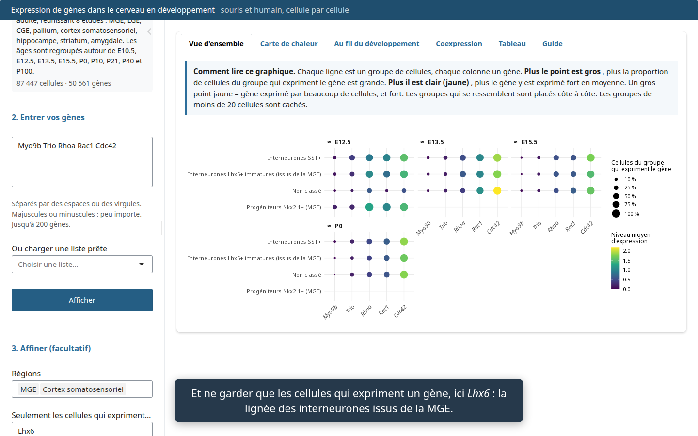
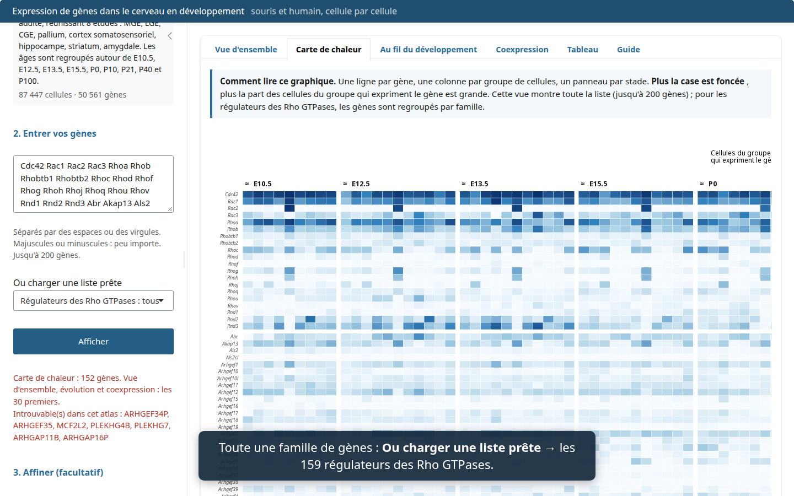
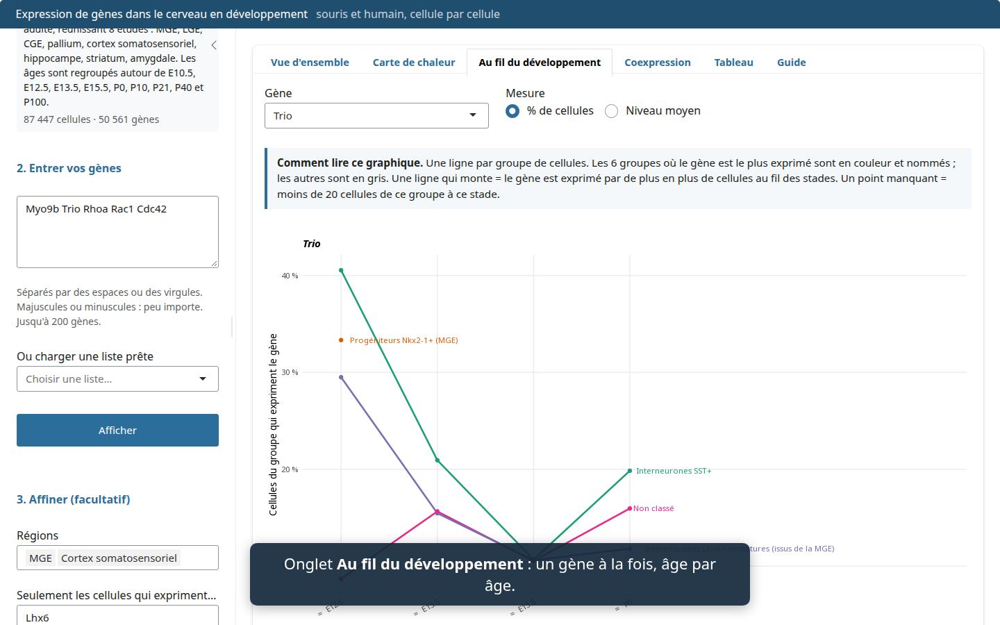
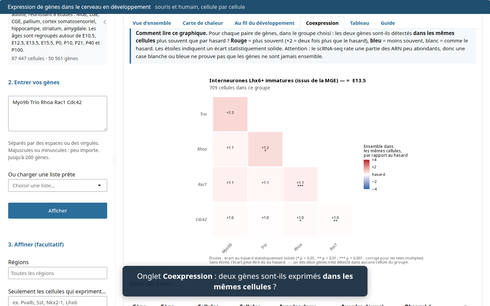

# brain-expr : où et quand vos gènes sont exprimés dans le cerveau en développement

Vous tapez une liste de gènes. L'app montre, pour chaque type cellulaire,
chaque région et chaque stade, le pourcentage de cellules qui expriment chaque
gène, son niveau moyen et la coexpression de chaque paire. Elle couvre cinq
atlas scRNA-seq, trois chez la souris et deux chez l'humain :

| Atlas | Espèce | Stades | Cellules dans l'app |
|---|---|---|---|
| **Souris · E10.5 → adulte, par région** (8 études, voir plus bas) | souris, prosencéphale | E9 → P132, regroupés autour de E10.5, E12.5, E13.5, E15.5, P0, P10, P21, P40, P100 | 87 447 (au plus 200 par étude × stade × région × type) |
| La Manno et al. 2021, *Nature* | souris, cerveau | E12.5, E13.5 | 21 479 (toutes) |
| Zeisel et al. 2018, *Cell* | souris, cerveau | P19–P23 | 64 170 (toutes) |
| Braun et al. 2023, *Science* | humain, cerveau entier | 5–14 semaines post-conception | 30 996 (au plus 200 par stade × classe) |
| Velmeshev et al. 2023, *Science* | humain, cortex | 2e trimestre → adulte | 12 530 (au plus 200 par âge × lignée) |

Tous les gènes de chaque atlas sont disponibles.

L'atlas **Souris · E10.5 → adulte** suit le prosencéphale région par région :
MGE, LGE et CGE disséquées séparément, pallium, cortex somatosensoriel,
hippocampe, striatum et amygdale. Il réunit :

| Étude | Ce qu'elle apporte |
|---|---|
| La Manno et al. 2021, *Nature* | Prosencéphale dorsal et ventral, E9 → E18 |
| Di Bella et al. 2021, *Nature* (GSE153162) | Cortex somatosensoriel, E10.5 → P4 |
| Lee et al. 2022, *eLife* (GSE167013) | MGE, LGE, CGE et cortex disséqués séparément, E12.5 |
| Mayer et al. 2018, *Nature* (GSE104156) | MGE Lhx6+ et CGE à E13.5, cortex et sous-cortex à E18.5 et P10 (cellules triées) |
| Allaway et al. 2021, *Nature* (GSE164570) | Lignée Dlx6+ de la MGE à E13 jusqu'au cortex à P28 (cellules triées) |
| Hochgerner et al. 2018, *Nat. Neurosci.* (GSE104323) | Gyrus denté, E16.5 → P132 |
| Zeisel et al. 2018, *Cell* | Amygdale, striatum, hippocampe, cortex somatosensoriel, P18 → P30 et P60 |
| Yao et al. 2023, *Nature* (Allen Brain Cell Atlas) | Striatum, amygdale (sAMY) et hippocampe adultes, P56 → P69 |

Chaque cellule y porte un **type cellulaire harmonisé**, attribué par la même
règle de marqueurs dans toutes les études (`extract/celltypes.R`) :
progéniteurs Nkx2-1+ de la MGE, neurones GABAergiques Dlx+, interneurones Lhx6+
immatures, interneurones PV+ et SST+, neurones de projection du striatum,
neurones excitateurs, astrocytes, lignée oligodendrocytaire, microglie et
macrophages. L'annotation publiée par les auteurs reste disponible à côté.

**Vidéo de démonstration (3 min) :** <https://sounkou-bioinfo.github.io/brain-expr/walkthrough.mp4>









## Utiliser l'app

- **Dans le navigateur :** <https://sounkou-bioinfo.github.io/brain-expr/>.
  Rien à installer. Le premier chargement prend une dizaine de secondes.
- **Sur l'ordinateur, hors ligne :** téléchargez l'installeur pour Windows (`.exe`),
  macOS (`.dmg`) ou Linux (`.AppImage`) depuis la page
  [Releases](https://github.com/sounkou-bioinfo/brain-expr/releases).
  Les builds ne sont pas signés. Sous Windows : « Informations complémentaires »
  puis « Exécuter quand même ». Sous macOS : ouvrir une première fois, puis
  Réglages Système > Confidentialité et sécurité > « Ouvrir quand même ».

Dans l'app :

1. Choisissez l'atlas.
2. Collez vos gènes (jusqu'à 200), séparés par des espaces, des virgules ou
   des retours à la ligne, ou chargez une liste prête : les 159 régulateurs des
   Rho GTPases (familles HGNC, avec l'orthologue souris MGI), une famille seule,
   ou les marqueurs de la lignée des interneurones. La casse ne compte pas :
   `Pax6` trouve `PAX6` chez l'humain. Les gènes absents de l'atlas sont
   signalés en rouge.
3. Affinez si besoin : choisissez des **régions**, ou ne gardez que les
   **cellules qui expriment** un gène (par exemple `Pvalb` ou `Lhx6`).
4. Cliquez sur **Afficher**. Chaque onglet commence par un encadré « Comment
   lire ce graphique » :
   - **Vue d'ensemble** : un point par gène et par groupe de cellules ;
   - **Carte de chaleur** : toute la liste, rangée par famille de régulateurs Rho ;
   - **Au fil du développement** : un gène, stade par stade ;
   - **Coexpression** : deux gènes sont-ils dans les mêmes cellules ?
   - **Tableau** : les chiffres, à télécharger en CSV ;
   - **Guide** : les atlas, les mesures, les précautions et un petit lexique.

Les groupes de moins de 20 cellules à un stade sont cachés : sur si peu de
cellules, un pourcentage ne veut rien dire.

## Ce que calcule l'app

Les données sont lues gène par gène, au moment où vous cliquez. Pour chaque
gène, stade et type cellulaire :

- **% de cellules** qui ont au moins un UMI du gène ;
- **moyenne** de log(1 + 10 000 × comptes / total de la cellule), sur toutes les
  cellules du groupe.

Pour chaque paire de gènes, la **coexpression** compare le nombre de cellules
où les deux gènes sont détectés au nombre attendu s'ils étaient indépendants,
avec un test hypergéométrique unilatéral et une correction de
Benjamini-Hochberg.

## Comment c'est construit

Tout est en R. L'app tourne en R compilé en WebAssembly (webR, via
[shinylive](https://posit-dev.github.io/r-shinylive/)). Dans le navigateur
comme dans l'app de bureau
([shinyelectron](https://github.com/coatless-rpkg/shinyelectron)), elle ne
dépend d'aucun serveur R.

Les atlas d'origine pèsent environ 47 Go. `extract/extract.R` les lit avec
[rhdf5](https://bioconductor.org/packages/rhdf5/) et écrit pour chacun un
*store* compact, rangé par gène (format décrit dans `app/store.R`) :

| Fichier | Contenu |
|---|---|
| `meta.dcf` | nom, citation, niveaux d'annotation, échantillonnage |
| `cells.tsv.gz` | une ligne par cellule : stade, annotations, total d'UMI |
| `genes.tsv.gz` | position et taille du bloc de chaque gène dans `matrix.bin` |
| `matrix.bin` | un bloc compressé par gène : cellules non nulles et comptes |

Les cinq stores pèsent 442 Mo. L'app ne lit que les blocs des gènes demandés,
par requêtes HTTP Range, avec `readBin()` et `memDecompress()` de R de base.
Lire dix gènes prend environ une seconde.

### Refaire les stores

Téléchargez les fichiers d'origine dans un dossier `data/` :

| Fichier | Source |
|---|---|
| `dev_all.loom` | [linnarssonlab.org/adolmouse/downloads.html](https://linnarssonlab.org/adolmouse/downloads.html) |
| `l5_all_rev1.loom` (décompresser `adult_mouse_l5_all_rev1.loom.gz`) | [github.com/linnarsson-lab/adolescent-mouse](https://github.com/linnarsson-lab/adolescent-mouse) |
| `human_dev.h5ad` | [github.com/linnarsson-lab/developing-human-brain](https://github.com/linnarsson-lab/developing-human-brain) |
| `velmeshev2023.h5ad` | [CELLxGENE, collection Velmeshev 2023](https://cellxgene.cziscience.com/collections/bacccb91-066d-4453-b70e-59de0b4598cd) |
| `velmeshev_meta.tsv` | [UCSC Cell Browser, pre-postnatal-cortex/all/rna/meta.tsv](https://cells.ucsc.edu/?ds=pre-postnatal-cortex) |

```bash
Rscript extract/extract.R data stores          # ~5 min, écrit stores/<atlas>/
```

L'atlas `souris_dev` lit en plus les fichiers GEO des six autres études et
l'atlas adulte Allen (environ 21 Go), que `extract/fetch_mouse_dev.sh`
télécharge :

```bash
bash extract/fetch_mouse_dev.sh data            # GEO + Allen Brain Cell Atlas
Rscript extract/mouse_dev.R data stores        # ~8 min, écrit stores/souris_dev/
```

L'échantillonnage (`CELLS_PER_GROUP` pour l'humain, `CAP` pour `souris_dev`) et
la graine se règlent en tête de chaque script. Les marqueurs des types
harmonisés sont dans `extract/celltypes.R`.

### Lancer, tester, construire

```bash
BRAIN_EXPR_DATA=stores Rscript -e 'shiny::runApp("app")'   # R natif
BRAIN_EXPR_DATA=stores Rscript tests/test_app.R app        # logique serveur, 4 atlas
python tests/walkthrough.py <url_du_site> out/              # parcours navigateur + vidéo
Rscript build_desktop.R stores site                         # site statique : build/site
Rscript build_desktop.R stores linux                        # app de bureau : build/electron-app/dist
```

### Publication

Le workflow `.github/workflows/publish.yml` récupère les stores de la release
[`data-v2`](https://github.com/sounkou-bioinfo/brain-expr/releases/tag/data-v2)
et vérifie leur somme SHA-256. Il teste ensuite l'app sur les cinq atlas.

- À chaque push sur `main`, il publie la version web sur GitHub Pages.
- À chaque tag `v*`, il construit les apps Windows, macOS et Linux et les
  attache à la release du tag.

## Limites

- Les atlas diffèrent par protocole, profondeur et annotation. Comparez les
  profils relatifs au sein d'un atlas, pas les niveaux absolus entre atlas.
- Les stades souris et humains ne se correspondent qu'à peu près : E12.5–E13.5
  correspond au premier trimestre, P21 plutôt à l'enfance.
- Chez l'humain, le sous-échantillonnage ne biaise pas les pourcentages ni les
  moyennes par groupe, mais il réduit la puissance de la coexpression.
- La recherche ignore la casse mais n'utilise pas de table d'orthologues. Un gène
  dont le nom diffère entre souris et humain sera signalé absent.
- Le scRNA-seq rate une partie des transcrits peu exprimés. Une absence de
  détection ou de coexpression n'est pas une preuve d'absence. Pour valider,
  utilisez l'ISH (Allen Developing Mouse Brain Atlas) ou des données spatiales.
- shinyelectron se décrit comme un prototype. Testez l'installeur avant de
  l'envoyer.

## Licence

Le code de ce dépôt est sous licence GPL-2.0-or-later (voir `LICENSE`). Les
données restent sous la licence de chaque atlas d'origine.
